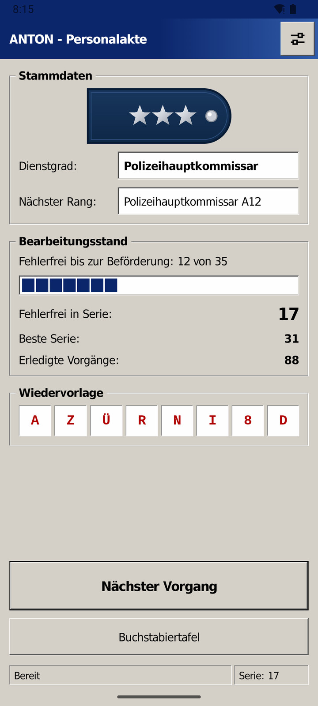
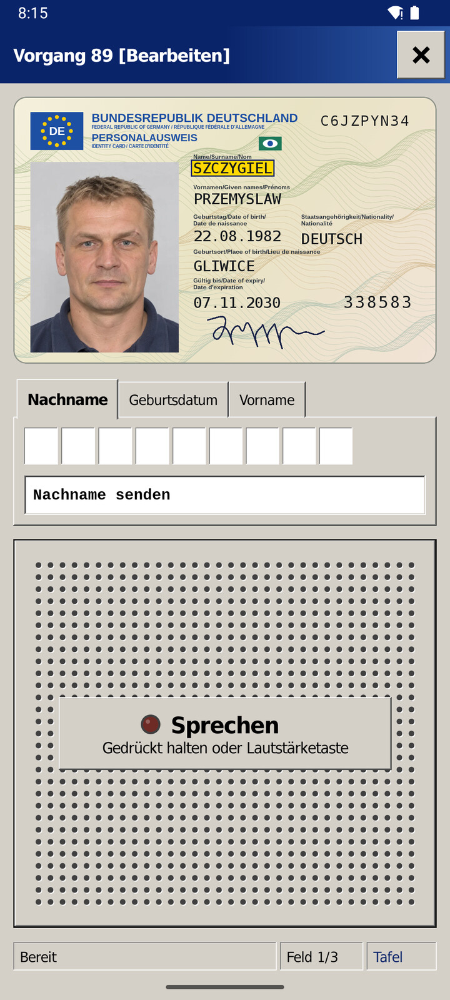
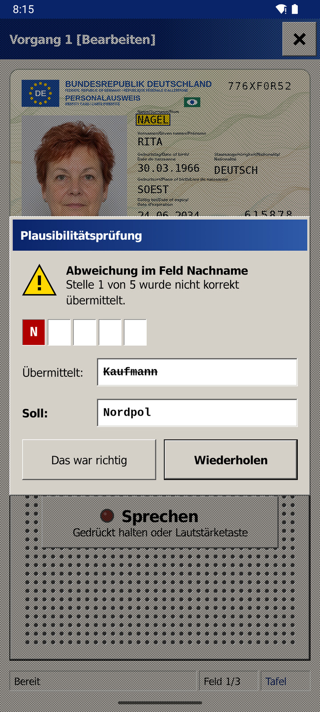
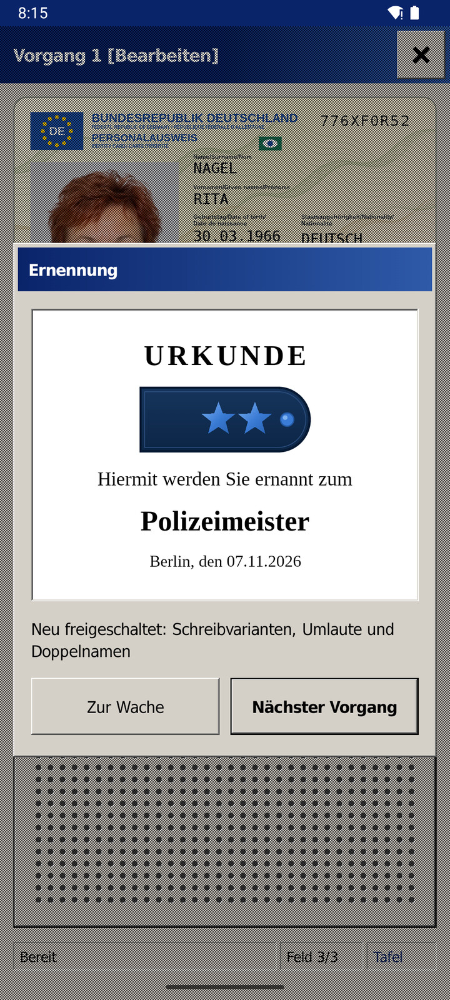
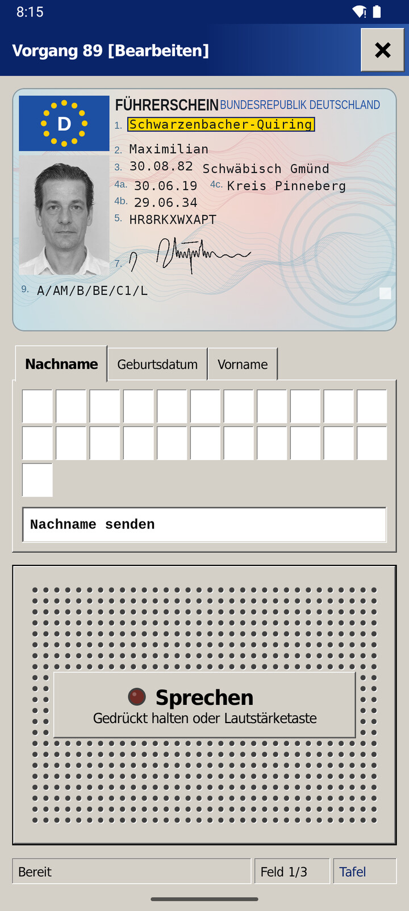
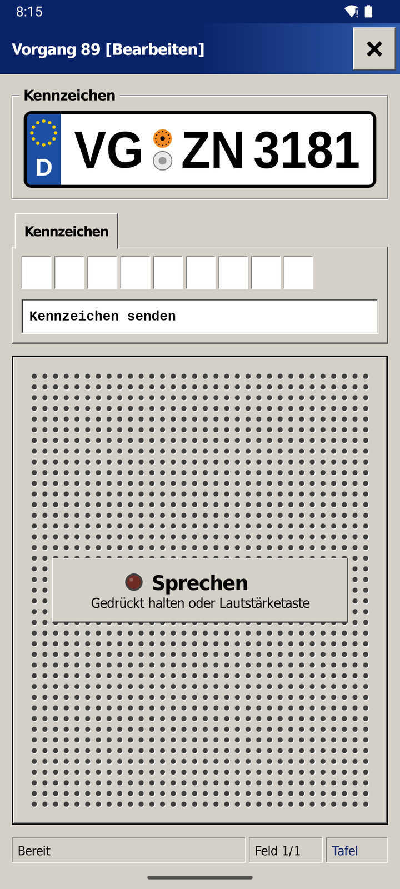
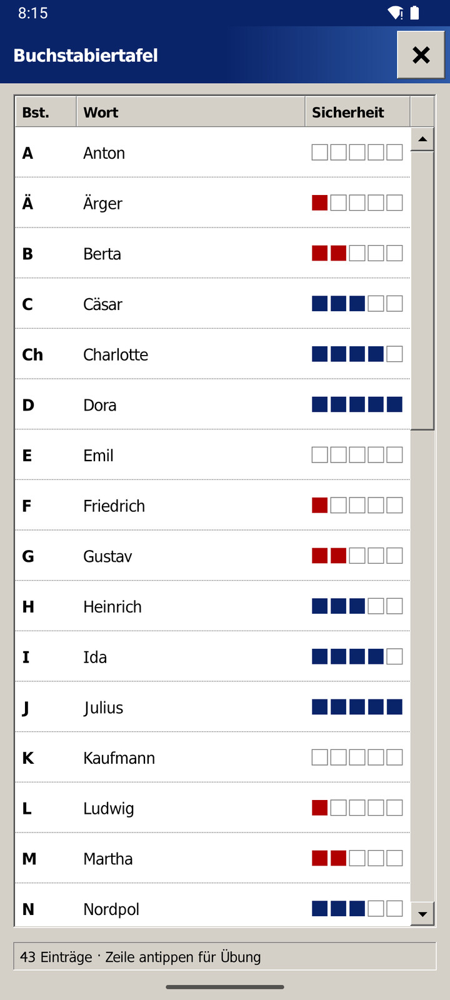
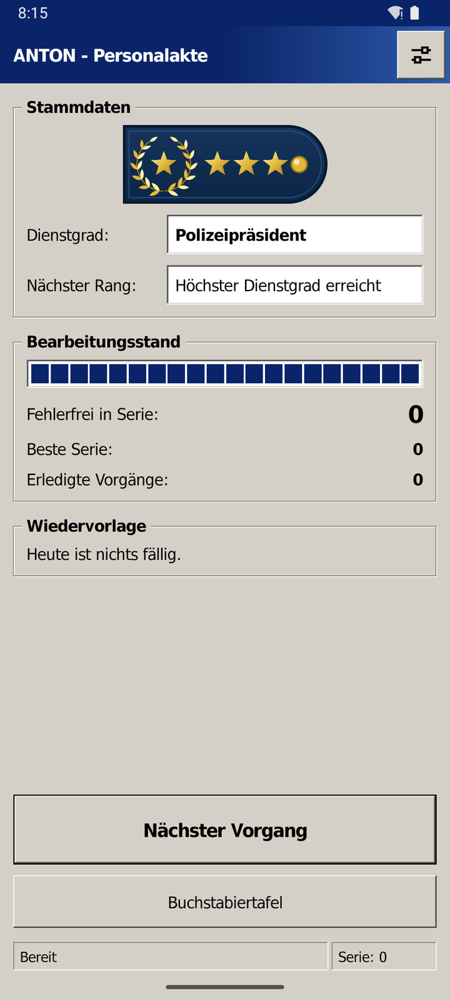

<p align="center">
  
</p>

<h1 align="center">Anton</h1>

<p align="center">
  An Android app that trains German police officers to spell correctly over the radio, fully offline and open source.
</p>

<p align="center">
  
  
  
  
  <a href="LICENSE"></a>
</p>

| Open your Personnel File | Spell the Case | Check the Deviation | Earn the Next Rank |
|:---:|:---:|:---:|:---:|
|  |  |  |  |

<details>
<summary>Show more screens</summary>
<br>
<table>
  <tr>
    <td></td>
    <td></td>
    <td></td>
    <td></td>
  </tr>
</table>
</details>

Meier or Mayer, Schwarzenbacher-Quiring, VG-ZN 3181: Anton hands you fictional ID cards,
driving licences and licence plates, and you transmit them by speaking the classic German
spelling alphabet, from Anton and Berta to Xanthippe and Zacharias. Error-free cases carry
you up the ranks of the Berlin police, and letters you are unsure of come back more often.
There are no timers and no leaderboards: what counts is getting it right. Speech recognition
runs on your phone, and the app has no internet permission, so your voice never leaves the
device. The app itself is in German.

<p align="center">
  <a href="#install">Install</a> ·
  <a href="#usage">Usage</a> ·
  <a href="#accuracy">Accuracy</a> ·
  <a href="#building">Building</a> ·
  <a href="#contributing">Contributing</a> ·
  <a href="#acknowledgements">Acknowledgements</a> ·
  <a href="#license">License</a>
</p>

## Install

There is no prebuilt release yet, so build it yourself: with a phone attached via USB
debugging, follow [Building](#building). Anton needs Android 8 or newer and an ARM phone.

## Usage

1. Allow the microphone and tap "Nächster Vorgang".
2. Hold the on-screen talk button or a volume key.
3. Spell the marked field. Surname, date of birth and first name follow one after the other,
   so you can send a whole case without letting go.
4. If Anton reports a deviation, repeat the field. If you spelled it correctly and Anton
   misheard you, tap "Das war richtig" and it won't count against you.

Digits are spoken one by one, with "zwo" instead of "zwei", and a hyphen is spoken as
"Trennung". Looking at the spelling table during a case costs your streak. Tap a row in the
table outside a case to drill that letter.

## Accuracy

Anton recognizes a fixed vocabulary of spelling words, digits and about 430 wrong words, such
as first names that aren't in the table. Measured with synthetic German voices, not with real
speakers, about 78% of correctly spelled sequences are recognized as correct and about 83% of
wrong words are reported. A few names that sound like a spelling word, such as Paul or Marta,
are left out on purpose, because they would make the correct words harder to recognize.

## Building

You need JDK 17 and the Android SDK 37. The first build downloads the speech model. With a
phone attached via USB debugging:

```sh
./gradlew :app:installDebug
```

See [`AGENTS.md`](AGENTS.md) for all commands and [`docs/spec.md`](docs/spec.md) for how the
app is meant to work.

## Contributing

Bug reports and feature requests are welcome:
[open an issue](https://github.com/EiSiMo/anton/issues). Reports about words Anton keeps
mishearing help the most.

## Acknowledgements

Anton stands on the shoulders of others' work:

- [Vosk](https://alphacephei.com/vosk/) by Alpha Cephei and its model
  `vosk-model-small-de-0.15` do the speech recognition (Apache 2.0).
- [Wine Tahoma](https://gitlab.winehq.org/wine/wine/-/tree/master/fonts) gives the interface
  its look (LGPL 2.1 or later).
- [Liberation Fonts](https://github.com/liberationfonts/liberation-fonts) (OFL) and
  [DejaVu Fonts](https://dejavu-fonts.github.io/) set the documents.

All persons and documents in the app are fictional, and the portraits are AI-generated.

## License

[MIT](LICENSE). Third-party components are listed in [THIRD-PARTY-NOTICES.md](THIRD-PARTY-NOTICES.md).
